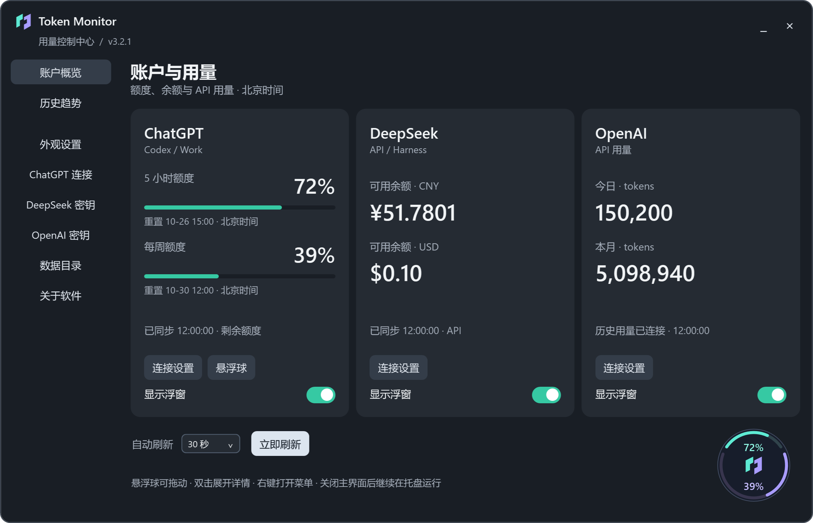

<p align="center">
  
</p>
<h1 align="center">Token Monitor</h1>
<p align="center"><strong>Your limits, balances and API usage at a glance.</strong><br>A Windows desktop monitor for Codex / ChatGPT Work, DeepSeek and OpenAI API.</p>
<p align="center">
  
  <a href="https://github.com/Ricki0613/TokenMonitor/releases/latest"></a>
  <a href="LICENSE"></a>
</p>
<p align="center">
  <a href="https://github.com/Ricki0613/TokenMonitor/releases/download/v3.2.1/TokenMonitor-v3.2.1-windows-x64.zip"><strong>Download for Windows</strong></a> ·
  <a href="#quick-start">Quick start</a> ·
  <a href="docs/USER_GUIDE.zh-CN.md">User guide (Chinese)</a> ·
  <a href="README.md">中文</a>
</p>

[](assets/readme-hero.png)

<p align="center"><sub>Dashboard and desktop orb shown together · Simulated data · Click for the full-resolution image</sub></p>

## Keep usage close

See three services in one dashboard while coding or calling models, then keep the figures you need on your desktop.

- **Compact quota orb**: two percentages show remaining 5-hour and weekly quota. Drag to move, double-click for details, and choose from five sizes.
- **Independent floating windows**: show, hide, move and resize each service separately. Connected services keep refreshing when their floats are hidden.
- **Local history**: 7-day and 30-day charts with 90-day retention. Missing observations remain missing.
- **Personal appearance**: light, dark or system theme, three font sizes and persistent sidebar navigation.
- **Updates and rollback**: download in the app, verify the package, confirm a restart, and retain the previous version for rollback.

## Supported data

| Service | What you can see | Connection |
| --- | --- | --- |
| **ChatGPT / Codex** | Shared Codex / ChatGPT Work remaining quota, reset times and available reset credits | Locally signed-in Codex |
| **DeepSeek** | Available, topped-up and granted balances, separated by currency | API Key or local DeepSeek Harness sign-in |
| **OpenAI API** | Today/month tokens, input/output/cached input and request counts for a selected API Key ID | Ordinary API Key; history also requires an Admin API Key and matching Key ID |

ChatGPT data covers the Codex / ChatGPT Work quota pool. OpenAI statistics cover requests reported by the official `usage/completions` endpoint; cached input is already included in input tokens.

## Quick start

**Requires Windows 10 / 11 x64 and .NET Framework 4.8.** Python, Node and the .NET SDK are not needed to run the app. The UI is currently Chinese.

1. [Download the Windows ZIP](https://github.com/Ricki0613/TokenMonitor/releases/download/v3.2.1/TokenMonitor-v3.2.1-windows-x64.zip) and extract the entire archive. Choose the runtime ZIP rather than GitHub's generated `Source code` archive.
2. Run **Install.cmd** and choose installation and data directories. The installer creates desktop and Start menu shortcuts. You can also run the extracted `TokenMonitor.exe` directly.
3. Use each card's **Connection settings** to connect the services you need, then enable their floats or the quota orb.

Refresh defaults to **30 seconds**. Select 15 / 30 / 60 / 120 seconds or refresh manually from the dashboard. Closing the main window hides it to the tray; double-click the tray icon to restore it, or use its menu to exit.

See [installation and troubleshooting](docs/START_HERE.zh-CN.md) and the [full user guide](docs/USER_GUIDE.zh-CN.md), both in Chinese.

### DeepSeek: API Key or Harness

Enter an API Key in **DeepSeek 密钥**, or sign in to Harness under the same Windows user and select **DeepSeek 密钥 → DeepSeek 余额来源 → DeepSeek Harness 登录账户**. Save the selection; Harness does not need to remain running.

Harness mode combines recharge and bonus wallets per currency. It reads the default local grant on demand without copying it into Token Monitor. You can switch between the two sources. Custom Harness data directories and unofficial servers are unsupported. See [credential handling](SECURITY.md).

### OpenAI: key verification and usage access

Verify your ordinary API Key, then supply an organization **Admin API Key** and the matching **API Key ID** (`key_…`). Successful ordinary-key verification does not grant access to usage history. Incomplete configuration shows the next step rather than a zero-usage result. See the [setup guide](docs/USER_GUIDE.zh-CN.md).

## History, updates and local data

### 7-day and 30-day trends

Charts use Beijing time (UTC+8). ChatGPT and DeepSeek retain the latest successful observation per 15-minute bucket. These are local-source histories; changing the signed-in account affects the curve.

OpenAI daily totals are stored separately by a hash of Key ID. Each fetch revises the retrieved current-month daily values; earlier months retain previously collected observations. Today's totals are provisional.

**Balance changes are not spending.** Top-ups, grants and refunds also affect DeepSeek balances.

### In-app updates

Open **关于软件** to check updates, read release notes and download a package. The app checks SHA-256 and executable version before asking to restart and install. Settings, credentials and history are retained; the previous program version can be restored from the same page.

Stable releases are checked at startup and every six hours after a successful check. Network failures and GitHub rate limits do not stop usage monitoring; a manual release-page link remains available. Versions v3.1.0 and earlier need a manual first upgrade.

[Release history](https://github.com/Ricki0613/TokenMonitor/releases) · [Changelog](CHANGELOG.md)

### Your data stays local

Normal operation and credential saving need no administrator privileges. Data defaults to `%LOCALAPPDATA%\TokenMonitor`. Select a writable empty folder in **数据目录** to copy and verify settings, credentials and history before switching; the original remains a backup.

- DeepSeek and OpenAI keys use Windows DPAPI encryption for the current user.
- Harness credentials are read on demand and sent only to the official DeepSeek service.
- Usage checks do not send model inference requests. Redeeming an official quota-reset credit requires separate confirmation.
- Update checks send no account usage, credentials or local settings to GitHub.

See [SECURITY.md](SECURITY.md) for details. Statistics can be delayed by the provider. Automatic startup is not implemented, and releases are currently unsigned.

## Development and contributions

[Issues and feature requests](https://github.com/Ricki0613/TokenMonitor/issues/new/choose) and pull requests are welcome. Keep real credentials and account data out of screenshots, logs and commits. See [CONTRIBUTING.md](CONTRIBUTING.md).

<details>
<summary>Build and verify from source</summary>

```powershell
git clone https://github.com/Ricki0613/TokenMonitor.git
cd TokenMonitor
powershell -NoProfile -ExecutionPolicy Bypass -File .\scripts\build.ps1
powershell -NoProfile -ExecutionPolicy Bypass -File .\scripts\test.ps1
powershell -NoProfile -ExecutionPolicy Bypass -File .\scripts\test-ui.ps1
```

Output: `build/`. Builds use the .NET Framework C# compiler. Offline tests use simulated data and need no real accounts or keys. Generate packages with `scripts/package.ps1` and check installation with `scripts/test-package.ps1 -Archive <ZIP>`.

The README image is generated at 2x resolution from native WPF controls using `scripts/render-readme.ps1` and simulated data. Maintainers should publish a stable Release containing the runtime ZIP and mark it Latest; a Git tag alone does not trigger update notices.

</details>

## License

[MIT License](LICENSE) · Copyright (c) 2026 Ricki0613

An independent project, not affiliated with OpenAI or DeepSeek.
