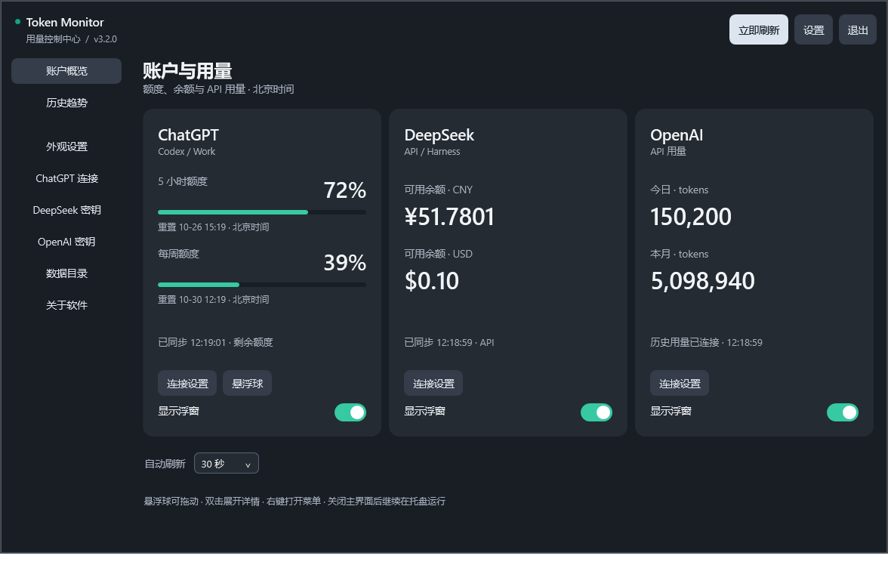

# Token Monitor

**Keep Codex / ChatGPT Work limits, DeepSeek API balances and OpenAI API token usage visible on your Windows desktop.**

Manage your accounts in the control center, then keep usage nearby with a compact orb or detailed floating windows.




The upper arc shows 5-hour remaining quota; the lower arc shows weekly remaining quota. Double-click to expand. Screenshots use simulated data.

[Download for Windows](https://github.com/Ricki0613/TokenMonitor/releases/download/v3.2.0/TokenMonitor-v3.2.0-windows-x64.zip) · [Release history](https://github.com/Ricki0613/TokenMonitor/releases) · [Changelog](CHANGELOG.md) · [Report an issue](https://github.com/Ricki0613/TokenMonitor/issues/new/choose) · [中文](README.md)

## Update checks

Checks the latest stable GitHub Release at startup and every 6 hours after success. A new version appears in Settings → About with one tray notification per version per run. Check manually from Settings → About or the tray (requests are at least one minute apart). Failures retry after one hour and do not interrupt usage monitoring. The download button fetches and verifies the release ZIP, then asks to restart and install. The previous version remains available for rollback.

Maintainers should publish an increasing `vMAJOR.MINOR.PATCH` release with the Windows ZIP and mark it **Latest**. Drafts, prereleases and Git tags without a release do not notify users. Checks send no credentials, settings or account usage to GitHub; GitHub receives ordinary request information such as IP address and app version.

## New in v3.2.0

A data-first dashboard with two ChatGPT quota bars, prominent DeepSeek balances, and OpenAI daily/monthly totals. Each card has connection settings and a labeled float switch. First launch starts with no floats. API key verification and historical usage connection are separate steps with actionable status messages. Hidden floats keep monitoring; floating window height is bounded by content to avoid empty space.

## Features

- A desktop control center, a ChatGPT quota orb with five sizes, and categorized settings within the main window. Appearance, size and refresh interval apply immediately; credentials require saving.

- Three independent, draggable, resizable, always-on-top windows with separate visibility switches.
- Cards reflow without shrinking text. Default height fits content; the ↕ button restores that height.
- Light, dark and system appearance, with saved window sizes and automatic system-theme updates.
- Redeem an official GPT quota-reset credit after confirmation, with retries that avoid duplicate redemption.
- Codex / ChatGPT Work remaining quota, official time windows, reset times and credits.
- DeepSeek available, topped-up and granted balances, displayed separately for each currency.
- OpenAI API usage for a configured API Key ID: input, output, cached input tokens and request counts for today and this month in UTC+8. Cached input is a subset of input tokens.
- Refresh every 15, 30, 60 or 120 seconds, or refresh manually.
- System tray, saved positions, single-instance launch and clear stale-data indicators.
- DeepSeek and OpenAI credentials encrypted for the current Windows user using DPAPI.

## Quick start

1. Download [TokenMonitor-v3.2.0-windows-x64.zip](https://github.com/Ricki0613/TokenMonitor/releases/download/v3.2.0/TokenMonitor-v3.2.0-windows-x64.zip) and extract the entire archive.
2. Run `Install.cmd`. Accept the default locations or enter preferred installation and data paths; the helper creates desktop and Start menu shortcuts. You can also run the extracted `TokenMonitor.exe` directly.
3. For GPT usage, install Codex and sign in locally. For DeepSeek, enter your own API Key in settings (设置). For OpenAI, sign in with an ordinary API Key; historical usage also requires an organization Admin API Key and the matching API Key ID.
4. Enable the windows you want. The OpenAI window starts disabled when upgrading an existing configuration and can be shown explicitly after connecting.

Requires Windows 10 / 11 x64 and .NET Framework 4.8. The application UI is currently Chinese; reset times use Beijing time (UTC+8). Python, Node and the .NET SDK are not required to run the app.

Normal operation and credential saving require no administrator privileges. Data defaults to `%LOCALAPPDATA%\TokenMonitor`. Choose a writable empty folder in the installer or **Settings → Choose data directory** to copy and verify existing settings and encrypted credentials before switching. The original remains a backup, and the selected path is remembered for your Windows user across restarts. Copying program files into a protected directory can still require Windows permission. The ZIP does not need a pre-created `data` folder.

To upgrade v1.0.0/v1.1.0, exit the old app from its tray menu, replace the program files in place and keep the old `data` directory. On startup, valid missing settings and a decryptable key are copied to per-user storage; originals remain and existing per-user data takes precedence. Run once in the old location before relocating the app. See [installation and troubleshooting](docs/START_HERE.zh-CN.md).

The GPT window reports **Codex / ChatGPT Work subscription quotas**, not every ChatGPT chat model's message limit. The DeepSeek window reports **account balances**, not historical account-wide token counts. The app does not send model inference requests to check usage.

OpenAI sign-in validates the ordinary key with `GET /v1/models`; restricted keys must allow this read operation. Historical usage comes from the official organization `usage/completions` endpoint and requires an **Admin API Key plus the target API Key ID**. Ordinary keys alone cannot retrieve organization usage; the window shows a configuration prompt until both fields are supplied. It reports model requests covered by that endpoint, not totals for every API endpoint, account balances, remaining tokens or ChatGPT subscriptions. Usage may be delayed.

Organization owners can create an Admin API Key at [Admin keys](https://platform.openai.com/settings/organization/admin-keys). Obtain the exact target key ID from the official project API-key listing endpoint; it is an identifier, not the `sk-…` secret. Check the key's name, creation time and redacted value to identify the signed-in key. The app does not infer that association. See the [setup guide](docs/USER_GUIDE.zh-CN.md).

## Build and test

```powershell
powershell -NoProfile -ExecutionPolicy Bypass -File .\scripts\build.ps1
powershell -NoProfile -ExecutionPolicy Bypass -File .\scripts\test.ps1
powershell -NoProfile -ExecutionPolicy Bypass -File .\scripts\test-ui.ps1
```

Output: `build/`. Offline self-tests cover credential storage, legacy migration, safe directory switching, OpenAI usage parsing and failure states. UI checks use mock data. These tests require no real accounts or API keys, send no model inference requests and never consume reset credits. UI screenshots are written to `build/ui-test-*/`. Runtime data and credentials are excluded from Git.

The release is unsigned. Automatic startup is not implemented. Updates download on request and require confirmation before restarting. Update checks require v2.1.0 or later. Service-side updates or API changes may affect availability.

## Contribute

Issues and pull requests are welcome. Include reproduction steps or the use case, and keep credentials and account data out of reports. See [CONTRIBUTING.md](CONTRIBUTING.md).

## License

[MIT](LICENSE). An independent project, not affiliated with OpenAI or DeepSeek.

## DeepSeek Harness account balance

Sign in to Harness under the same Windows user, then select the Harness account in Settings → DeepSeek balance source and save. Harness need not remain running. Reads the default `%USERPROFILE%\.dsh\.credentials.yaml` grant on each refresh; never copies it into Token Monitor storage. Requests go only to the fixed official DeepSeek Platform host, without redirects. Recharge and bonus wallets are summed per currency; API availability is not inferred. Existing configurations retain manual API Key mode. Verified with Harness Desktop 0.2.1-rc.2; custom Harness data roots and unofficial servers are unsupported.

## v3.2.0 history and updates

The fixed-size dashboard has persistent left navigation, top-right actions and three font sizes. Local 7/30-day charts retain 90 days of successful observations. Balance changes are not spending; credits, top-ups and refunds affect them. OpenAI daily totals revise fetched current-month data, separated by key ID. Missing history is not fabricated.

From v3.2.0, About downloads the official release ZIP, checks GitHub SHA-256 and executable version, then asks to restart. Previous binaries remain available for rollback; settings, credentials and history stay in place. Older clients need a manual upgrade first.
