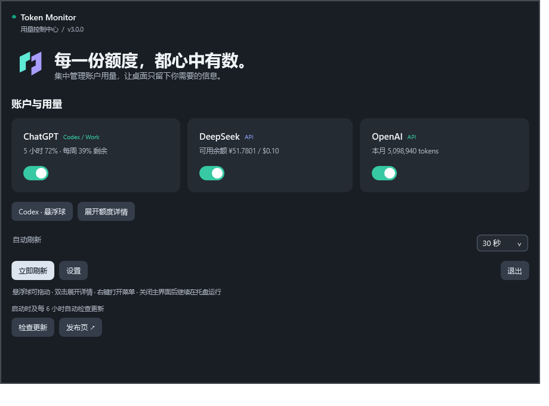
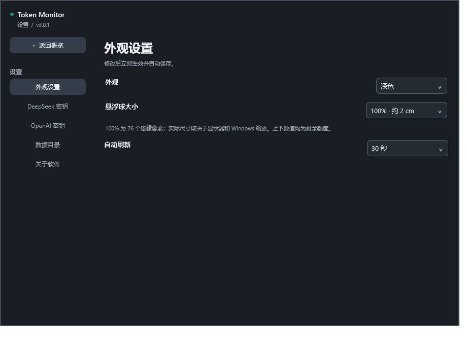

# Token Monitor

**Windows 桌面用量悬浮窗：随时查看 Codex / ChatGPT Work 额度、DeepSeek API 余额与 OpenAI API Token 用量。**

A lightweight Windows floating usage monitor for Codex / ChatGPT Work, DeepSeek and OpenAI API. Built with C# and WPF.

[下载 Windows 版](https://github.com/Ricki0613/TokenMonitor/releases/download/v3.0.1/TokenMonitor-v3.0.1-windows-x64.zip) · [v3.0.1 说明](docs/RELEASE_v3.0.1.md) · [安装与排错](docs/START_HERE.zh-CN.md) · [使用指南](docs/USER_GUIDE.zh-CN.md) · [更新记录](CHANGELOG.md) · [English](README.en.md)


> **需要应用内更新检测，请选择 v2.1.0 及以后版本。** v2.0.0 及更早版本没有更新检测，需要先手动升级一次。

## 最近更新

| 版本 | 日期 | 主要变化 |
| --- | --- | --- |
| [v3.0.1](https://github.com/Ricki0613/TokenMonitor/releases/tag/v3.0.1) | 2026-10-25 | 完整深色外观、分页设置、非密钥设置即时生效、ChatGPT 悬浮球命名 |
| [v3.0.0](https://github.com/Ricki0613/TokenMonitor/releases/tag/v3.0.0) | 2026-10-25 | 正式控制中心、Codex 双弧百分比悬浮球、五档尺寸和新标志 |
| [v2.2.0](https://github.com/Ricki0613/TokenMonitor/releases/tag/v2.2.0) | 2026-10-23 | 新增从 DeepSeek Harness 登录账户读取充值、赠送余额，无需 API Key |
| [v2.1.0](https://github.com/Ricki0613/TokenMonitor/releases/tag/v2.1.0) | 2026-10-11 | 新增启动及定时更新检测、托盘通知、手动检查和 GitHub 发布页下载入口 |
| [v2.0.0](https://github.com/Ricki0613/TokenMonitor/releases/tag/v2.0.0) | 2026-10-10 | 新增 OpenAI API Key 登录及独立用量浮窗，按指定 Key ID 展示今日、本月 Token 和请求数 |
| [v1.1.2](https://github.com/Ricki0613/TokenMonitor/releases/tag/v1.1.2) | 2026-10-08 | 安装助手与设置中均可自选数据目录，自动复制校验配置和密钥，重启后沿用所选路径 |
| [v1.1.1](https://github.com/Ricki0613/TokenMonitor/releases/tag/v1.1.1) | 2026-10-08 | 修复自选安装目录下保存 Key 的权限问题；配置改存当前用户目录，自动迁移旧配置；新增安装助手、准确错误提示与安装排错说明 |
| [v1.1.0](https://github.com/Ricki0613/TokenMonitor/releases/tag/v1.1.0) | 2026-10-07 | 浮窗缩放与卡片重排、浅色/深色/随系统、官方 GPT 额度重置、紧凑高度 |
| [v1.0.0](https://github.com/Ricki0613/TokenMonitor/releases/tag/v1.0.0) | 2026-10-07 | 首版 GPT 额度与 DeepSeek 余额双浮窗、定时刷新、托盘和加密密钥 |

[完整更新记录](CHANGELOG.md) · [全部发布版本](https://github.com/Ricki0613/TokenMonitor/releases)

## 一眼看清三种用量

| ChatGPT 窗口 | DeepSeek 窗口 | OpenAI API 窗口 |
| --- | --- | --- |
| Codex / ChatGPT Work 剩余额度百分比 | 可用余额 | 指定 API Key ID 的今日、本月用量 |
| 官方返回的 5 小时、每周等额度窗口 | 充值余额与赠送余额 | 输入、输出 Token 与请求数 |
| 北京时间重置时间与倒计时 | 人民币、美元分别显示 | 缓存输入 Token，属于输入 Token 的子集 |
| 额外 credits 与其他官方额度池 | 余额是否支持继续调用 API | 按北京时间（UTC+8）划分统计周期 |

三个窗口各自有显示开关，可以拖动、缩放、置顶、收起到托盘，并记住位置与尺寸。卡片随宽度重排，字号保持不变；默认高度紧贴内容，点击顶部 **↕** 可恢复贴合高度。设置支持 **浅色 / 深色 / 随系统**。默认每 **30 秒**刷新，可选 15 / 30 / 60 / 120 秒，也能随时手动刷新。网络异常时会标记旧数据与最后成功时间。

ChatGPT 浮窗新增 **重置额度**：显示官方剩余次数，确认后使用账户的一次重置权益，与 GPT 内使用重置次数相同。结果不确定时可安全重试，避免重复扣次数。

## 下载、安装与首次使用

1. **下载运行包**：[TokenMonitor-v3.0.1-windows-x64.zip](https://github.com/Ricki0613/TokenMonitor/releases/download/v3.0.1/TokenMonitor-v3.0.1-windows-x64.zip)，右键 → **全部解压**。
2. **安装**：双击解压后的 **Install.cmd**，按 Enter 使用默认位置，或分别填写程序位置和数据目录。助手创建桌面、开始菜单快捷方式并启动程序。也可直接运行解压后的 `TokenMonitor.exe`。
3. **连接账户**：DeepSeek 在“设置 → DeepSeek 余额来源”选择已登录的 Harness 账户，或填写自己的 API Key 并保存；GPT 先在本机安装并登录 Codex。OpenAI 在“设置”中使用普通 API Key 登录，读取历史用量还需组织 Admin API Key 和对应的 API Key ID。只开启需要的服务即可。
4. **日常启动**：使用 **Token Monitor** 快捷方式。关闭控制面板会收起到托盘，双击托盘图标可恢复。

**正常运行和保存 Key 不需要管理员权限。** 安装位置和数据目录均可自选；数据默认保存在 `%LOCALAPPDATA%\TokenMonitor`。也可在 **设置 → 选择数据目录** 指定自己的可写空文件夹，配置和密钥会自动复制、校验，成功后启用新路径，原目录保留备份。重启后继续使用所选路径。安装包无需包含 `data` 文件夹；将运行文件复制到受保护目录时，Windows 可能要求一次文件操作授权。

**升级旧版**：先从托盘退出，将新文件覆盖到原目录并保留旧 `data`，正常启动后自动迁移可用配置。已有新版用户配置优先，旧文件保留。迁移完成后可再换安装位置。

旧版配置中的 GPT、DeepSeek 开关和窗口布局继续保留，新增 OpenAI 窗口默认关闭；成功登录 OpenAI 后启用。

遇到保存失败、加密失败或缺少运行环境时，按 [安装与排错说明](docs/START_HERE.zh-CN.md) 操作。设置页可查看数据目录及具体错误代码。

**系统要求**：Windows 10 / 11 x64、.NET Framework 4.8。监控 GPT 时需要安装并登录 Codex。运行主程序不需要 Python、Node 或 .NET SDK。

Release 中的 Windows ZIP 是可直接运行的程序；GitHub 自动生成的 `Source code` 压缩包用于开发。

## 更新检测（v2.1.0 起）

启动时自动检查 GitHub 最新正式 Release，成功后每 6 小时复查。新版会显示在控制面板，并通过托盘通知提醒；同一版本在本次运行中只通知一次。控制面板或托盘菜单可手动 **检查更新**，两次请求至少间隔 1 分钟。

点击 **下载更新 ↗** 打开项目的对应发布页，下载 ZIP，退出旧程序后覆盖升级（保留数据目录），或运行新包的 `Install.cmd` 并选择原安装目录。程序不会自动下载或覆盖安装。断网、超时或 GitHub 限流时显示失败提示，1 小时后重试，用量监控继续运行；也可直接打开发布页。

维护者发布新版本时，使用递增的 `v主版本.次版本.修订号`（如 `v2.2.0`），附上运行包并将正式 Release 标记为 **Latest**。草稿、预发布和仅推送的 Git 标签不会触发提醒。

## 数据范围与隐私

- 更新检测仅访问本项目的公开 GitHub Release 接口，不发送本机配置、API Key 或账户用量；GitHub 会收到常规网络请求信息（如 IP 和应用版本）。
- GPT 显示 **Codex / ChatGPT Work 订阅额度**，不涵盖 ChatGPT 普通聊天的所有模型消息额度。
- DeepSeek 使用官方余额接口，**不是全账户 Token 历史统计**。点击窗口内“官方用量”可查看后台明细。
- OpenAI 使用官方组织 `usage/completions` 接口，并按你提供的 API Key ID 过滤。普通 API Key 用 `GET /v1/models` 验证登录；受限 Key 需允许读取该接口。普通 Key 本身不能读取组织历史用量，需补充 **Admin API Key 与 API Key ID**，未配置时显示待配置状态。
- OpenAI 统计涵盖官方 completions 用量接口覆盖的模型请求，**不是全部 API 端点的总用量**，不查询余额、剩余 Token 或 ChatGPT 订阅额度。缓存输入已包含在输入 Token 中，不重复相加。
- 程序通过本机官方 Codex 查询 GPT 额度，应用自身不读取或复制 OpenAI 登录令牌。
- DeepSeek API Key 及 OpenAI API/Admin Key 使用 Windows DPAPI 按当前用户加密保存，仅用于对应官方接口。
- 缺失字段不会被当作零，到达重置时间后等待官方返回新额度；查询不会发起模型对话。

详细说明见 [使用指南](docs/USER_GUIDE.zh-CN.md) 和 [凭据处理说明](SECURITY.md)。

## 从源码构建

```powershell
git clone https://github.com/Ricki0613/TokenMonitor.git
cd TokenMonitor
powershell -NoProfile -ExecutionPolicy Bypass -File .\scripts\build.ps1
powershell -NoProfile -ExecutionPolicy Bypass -File .\scripts\test.ps1
powershell -NoProfile -ExecutionPolicy Bypass -File .\scripts\test-ui.ps1
```

输出位于 `build\`。脚本使用 .NET Framework C# 编译器；65 项离线自测与 60 项界面检查使用模拟数据，覆盖密钥保存、旧配置迁移、数据目录切换、OpenAI 用量解析、更新检测与异常状态。无需真实账户或 API Key，不发送模型推理请求，不消耗重置次数。界面截图输出到 `build\ui-test-*\`。

发布包使用 `scripts/package.ps1` 生成；`scripts/test-package.ps1 -Archive <ZIP路径>` 执行 6 项安装检查，包括自选中文/空格路径、快捷方式、原地覆盖升级和损坏文件拦截。

| 目录 | 内容 |
| --- | --- |
| `src/` | C# / WPF 源码 |
| `assets/` | 程序图标 |
| `scripts/` | 构建、自测与图标生成脚本 |
| `installer/` | 普通用户安装助手与快捷方式创建 |
| `docs/` | 通用使用指南与发布说明 |
| `.github/` | Issue / Pull Request 模板 |

用户目录中的配置、密钥、旧版 `data/` 与构建产物不纳入版本控制。

## 参与贡献

欢迎 [提交问题或功能建议](https://github.com/Ricki0613/TokenMonitor/issues/new/choose)，也欢迎通过 Pull Request 改进工具。请写清楚复现步骤或使用场景，功能改动请运行构建、自测并检查界面。详见 [贡献指南](CONTRIBUTING.md)。

## 当前限制

- 当前界面为中文，重置时间使用北京时间（UTC+8）。
- 数据定时查询，可能存在服务端更新延迟；接口变化时可能需要适配。
- 暂无开机自启设置和自动下载安装；更新检测需 v2.1.0 及以后版本；发布的程序尚未代码签名。

## 许可证

[MIT License](LICENSE) · Copyright (c) 2026 Ricki0613

本项目为独立开源工具，与 OpenAI、DeepSeek 无官方隶属关系。

## DeepSeek Harness 余额

在同一 Windows 用户下先登录 DeepSeek Harness，再选择“设置 → DeepSeek 余额来源 → DeepSeek Harness 登录账户”并保存。无需保持 Harness 运行。按币种显示充值钱包、赠送钱包及合计；不推断 API 可调用状态。凭据只从 `%USERPROFILE%\.dsh\.credentials.yaml` 按需读取，不复制保存，仅发送到固定的 DeepSeek 官方 Platform 域名。原 API Key 模式可随时切回。已验证 Harness 0.2.1-rc.2；自定义数据目录与非官方服务器暂不支持。

## v3.0.0

正式桌面控制中心，配合可随时展开的 ChatGPT 额度悬浮球。青色上短弧显示 5 小时剩余百分比，紫色下长弧显示每周剩余百分比。双击展开，右键操作；设置中可选 80%–200% 五档尺寸。




截图使用模拟数据；100% 为 76 个逻辑像素，实际物理尺寸由显示器与 Windows 缩放决定。

## v3.0.1 设置与外观

在主窗口内切换外观、DeepSeek 密钥、OpenAI 密钥、数据目录及关于软件。主题、悬浮球大小和刷新间隔即时生效；密钥需点击保存。更新检查与发布页位于关于软件。




